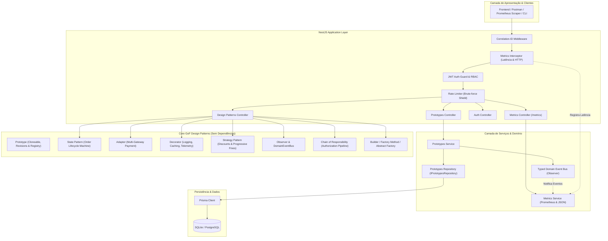
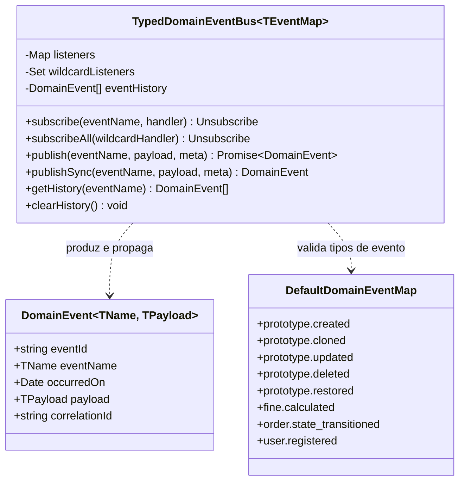
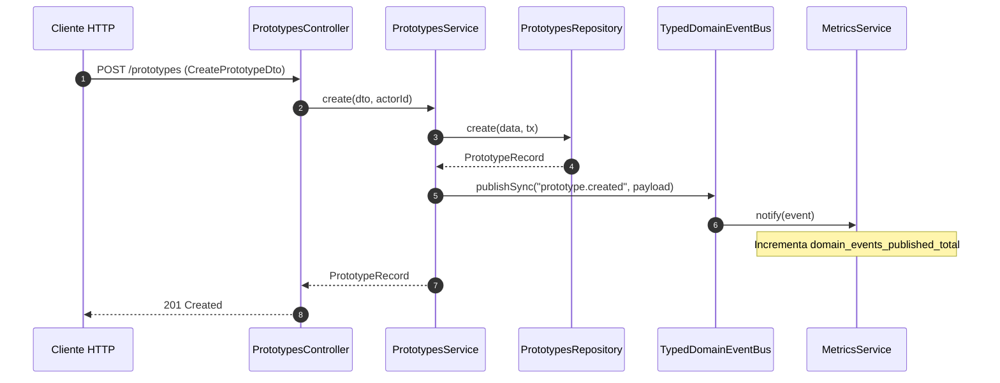
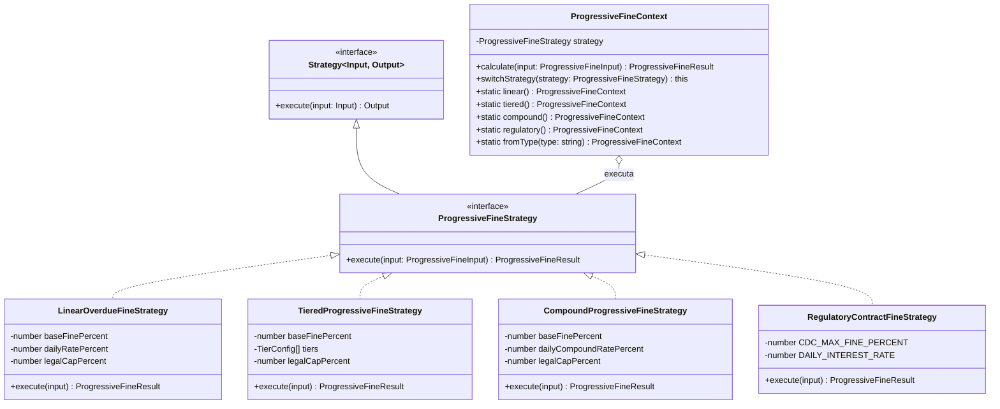
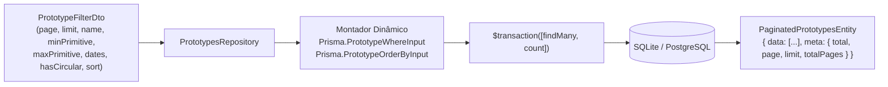
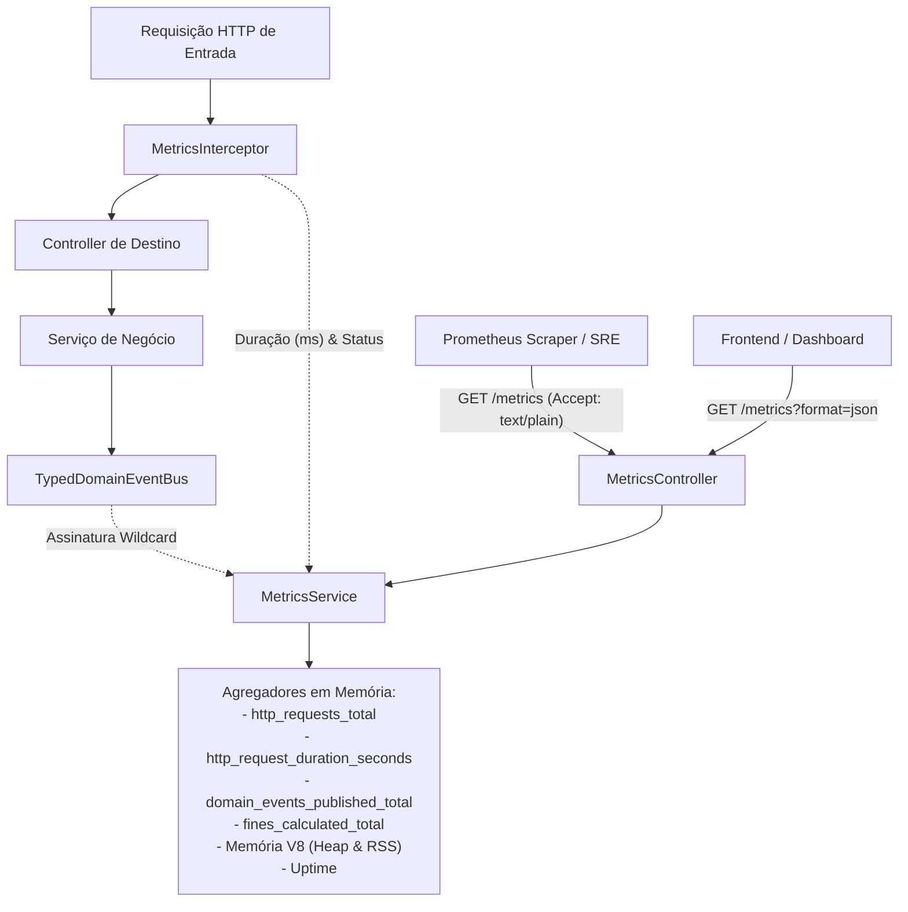

# Arquitetura do Sistema — TypeScript Design Patterns & Enterprise API

Este documento detalha a arquitetura de software, a organização em camadas, a matriz de padrões de projeto GoF, o barramento de eventos de domínio, o motor de multas progressivas com Strategy, a persistência com repositório dinâmico e o subsistema de telemetria Prometheus/JSON do ecossistema **Projeto-Typescript**.

---

## 1. Visão Geral da Arquitetura

O projeto divide-se em macro-camadas interdependentes mas estritamente desacopladas:

1. **Biblioteca Core de Padrões (`src/design-patterns/` e `src/prototype-pattern/`):** Implementações puras, tipadas e sem dependências externas de padrões GoF criacionais, estruturais e comportamentais.
2. **Barramento de Eventos de Domínio (`src/design-patterns/observer/domain-event-bus.ts`):** Pub/Sub fortemente tipado com suporte a handlers assíncronos, isolamento de falhas, wildcard listeners e auditoria de eventos.
3. **Motor de Cálculo de Multas Progressivas (`src/design-patterns/strategy/progressive-fine.ts`):** Família de algoritmos intercambiáveis de mora (Linear, Tiered, Composta, Regulatória CDC).
4. **Camada de Aplicação REST / NestJS (`src/prototypes/`, `src/auth/`, `src/users/`, `src/metrics/`):** Controladores, serviços, pipes de validação com class-validator, interceptors de telemetria e injeção de dependência.
5. **Camada de Persistência e Repositório (`src/prototypes/prototypes.repository.ts`, `prisma/`):** Padrão Repository desacoplado, com paginação robusta e filtros dinâmicos strongly typed sobre Prisma ORM (SQLite / PostgreSQL).
6. **Camada de Observabilidade e Métricas (`src/metrics/`):** Coleta contínua de latência, throughput, contadores de domínio e exposição no formato Prometheus e JSON estruturado.

---

## 2. Padrão Observer: Barramento Tipado de Eventos de Domínio

O **`TypedDomainEventBus`** estabelece um desacoplamento de alta fidelidade entre produtores e consumidores de eventos de domínio, assegurando tipagem estrita via TypeScript Generics.

### 2.1 Diagrama de Classes do EventBus

### 2.2 Fluxo Sequencial de Eventos de Domínio

---

## 3. Padrão Strategy: Cálculo de Multas Progressivas

O módulo de multas progressivas (`src/design-patterns/strategy/progressive-fine.ts`) implementa uma família de estratégias de amortização, juros de mora e penalidades contratuais escalonadas.

### 3.1 Diagrama de Classes do Motor de Multas

### 3.2 Matriz Comparativa de Estratégias de Multa

| Estratégia | Regra de Multa Base | Regra Diária (Mora) | Teto Legal | Conformidade / Aplicação |
| :--- | :--- | :--- | :--- | :--- |
| **Linear** | 2% fixo no atraso | 0.10% / dia linear | 20% | Contratos comerciais gerais |
| **Tiered (Escalonada)** | 2% (+0.5% por reincidência) | Faixas progressivas (0.10% a 0.60%/dia) | 30% | Inadimplência prolongada B2B |
| **Compound (Composta)** | 2% fixo | Juros compostos exponenciais dia a dia | 25% | Operações financeiras de alta volatilidade |
| **Regulatory (CDC)** | 2% fixo (Art. 52 CDC) | 1% ao mês pro rata die (0.0333%/dia) | Estrito CDC | Código de Defesa do Consumidor & Bacen |

---

## 4. Repositório com Paginação e Filtros Dinâmicos

A persistência de protótipos foi desacoplada por meio do `PrototypesRepository` (`IPrototypesRepository`), com suporte a consultas dinâmicas de alta performance.

### Filtros Suportados:
- **`name`**: Busca textual parcial com suporte a case-insensitivity.
- **`minPrimitive` / `maxPrimitive`**: Intervalo fechado de inteiros (32-bit).
- **`startDate` / `endDate`**: Intervalo cronológico de componentes em ISO 8601.
- **`hasCircular`**: Filtro booleano por existência de relação 1:1 com referência circular.
- **`sortBy` / `sortOrder`**: Ordenação dinâmica por `id`, `name`, `primitive`, `component`, `createdAt` ou `version` em ordem `asc` ou `desc`.

---

## 5. Arquitetura de Observabilidade e Métricas (Prometheus & JSON)

O módulo `src/metrics/` provê telemetria em conformidade com o formato padrão Prometheus (OpenMetrics) e representação JSON enriquecida via endpoint unificado `GET /metrics`.

---

## 6. Pipeline CI/CD e Contêiner Docker Multi-Stage

- **CI/CD (`.github/workflows/ci.yml`):**
  - Matriz de testes automatizados com Node.js 22.x e 24.x.
  - Verificação rigorosa de formatação Prettier, linting com ESLint, checagem de tipos estrita (`tsc --noEmit`), compilação NestJS, testes unitários completos com Jest e testes ponta-a-ponta (E2E) em SQLite e PostgreSQL 17 temporário.
- **Dockerfile Multi-Stage (`Dockerfile`):**
  - **Estágio 1 (`deps`):** Instalação das dependências completas com Node 22 Alpine.
  - **Estágio 2 (`builder`):** Geração do Prisma Client otimizado para Alpine musl e compilação do NestJS.
  - **Estágio 3 (`runner`):** Imagem final enxuta executando sob usuário não-root `node`, com `dumb-init` para gestão de sinais de terminação, volume persistente `/app/data` e healthcheck automatizado no endpoint `/metrics`.
