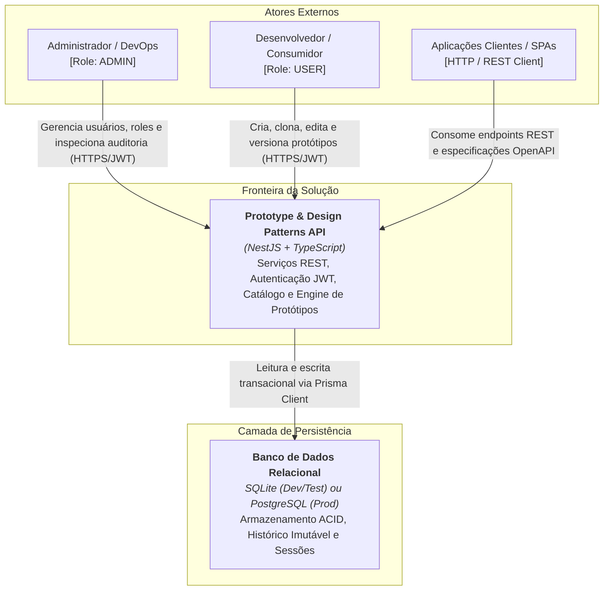
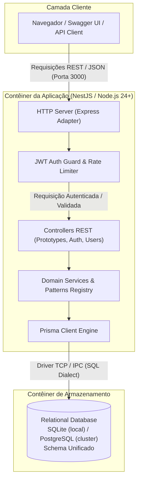
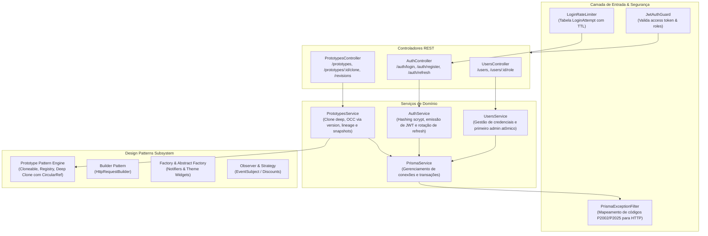
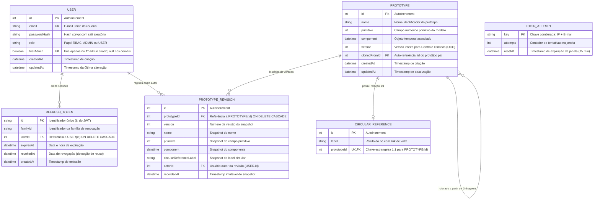

# Arquitetura do Sistema e Modelo de Dados

Este documento especifica a arquitetura técnica, os diagramas C4 (Contexto, Contêineres e Componentes), o Modelo Entidade-Relacionamento (ERD) e os mecanismos de escalabilidade e concorrência do **Projeto TypeScript**.

---

## 1. Visão Geral e Diagramas C4

A arquitetura do sistema adota os princípios de separação de responsabilidades (SoC), arquitetura em camadas modular com **NestJS**, desacoplamento de banco de dados via **Prisma ORM** e implementação de padrões de projeto GoF clássicos (com destaque para o *Prototype Pattern* com suporte a referências circulares e linhagem).

### 1.1 C4 Nível 1: Diagrama de Contexto de Sistema

Exibe os atores externos e os limites do sistema.

---

### 1.2 C4 Nível 2: Diagrama de Contêineres

Detelha as aplicações executáveis, armazenamento e fronteiras de comunicação.

---

### 1.3 C4 Nível 3: Diagrama de Componentes

Mapeia a organização interna dos módulos NestJS e o subsistema de padrões de design.

---

## 2. Diagrama Entidade-Relacionamento (ERD)

O esquema relacional é mantido pelo Prisma e sincronizado de forma idêntica entre **SQLite** e **PostgreSQL**.

---

## 3. Padrões de Dados e Resiliência

### 3.1 Controle Otimista de Concorrência (OCC)
Para suportar múltiplas instâncias da API sem deadlocks em nível de linha:
- O campo `version` em `Prototype` é incrementado a cada mutação (`UPDATE prototypes SET version = version + 1 WHERE id = :id AND version = :expectedVersion`).
- Caso o número de linhas afetadas seja `0`, a aplicação detecta conflito de edição concorrente e retorna `409 Conflict`, orientando o cliente a recarregar o estado mais recente.

### 3.2 Imutabilidade e Event Sourcing (Audit Trail)
- Cada alteração em um `Prototype` (criação, edição, clone ou restauração) gera uma linha em `PrototypeRevision`.
- O par `(prototypeId, version)` possui restrição de unicidade (`@@unique([prototypeId, version])`), garantindo que o histórico nunca retroceda nem sobrescreva registros prévios.
- O campo `actorId` preserva a rastreabilidade (quem executou a operação), mantendo-se nulo (`ON DELETE SET NULL`) caso o usuário venha a ser excluído.

### 3.3 Sessões Distribuídas e Rotação de Tokens
- **Refresh Token Rotation (RTR):** A cada chamada para `/auth/refresh`, o token apresentado é marcado com `revokedAt = now()`, e um novo token é gerado com o mesmo `familyId`.
- **Detecção de Replay:** Se um token já revogado for reapresentado, o sistema assume comprometimento de credencial e revoga imediatamente todos os tokens associados àquele `familyId`.

### 3.4 Rate Limiting Distribuído e Proteção Anti-Força-Bruta
- A tabela `LoginAttempt` armazena a chave composta `IP:email` e a data de reset.
- Por residir no banco de dados com índice em `resetAt`, a proteção é horizontalmente compartilhada entre nós da API sem exigir dependência rígida de instâncias de cache volátil em configurações mínimas.
